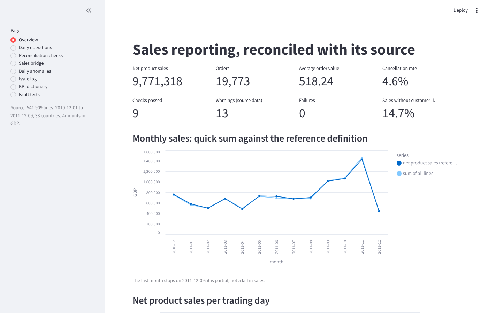
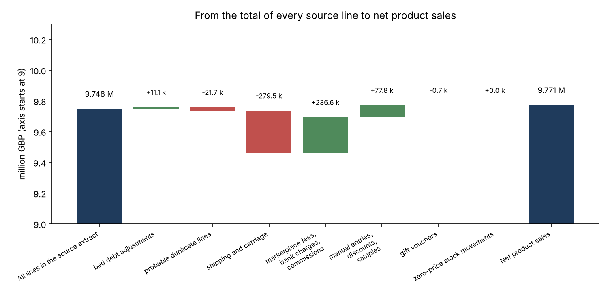
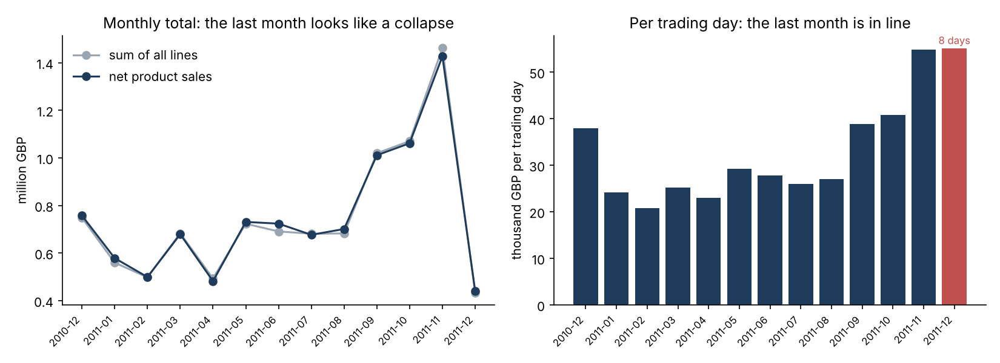
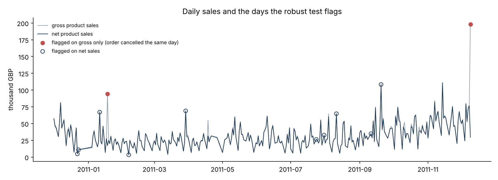
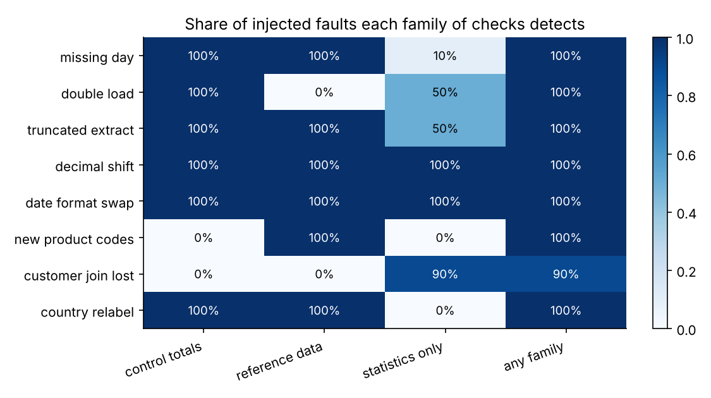
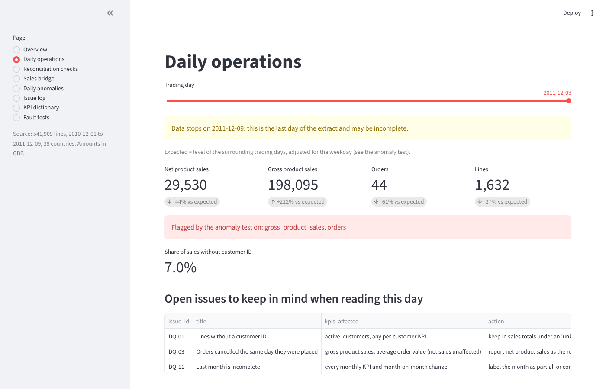
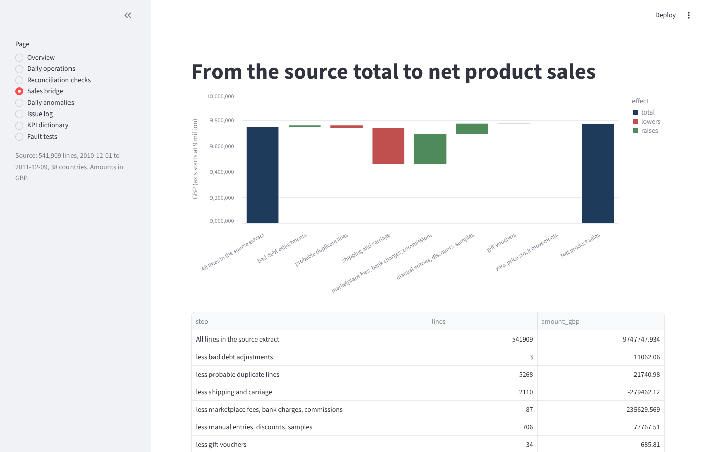

# BI reconciliation toolkit

[](https://github.com/Abderrahmane-BOULAMI/bi-reconciliation-toolkit/actions/workflows/tests.yml)

A sales report is only used if people trust it, and they trust it when every figure can be traced back to the source. This project takes one year of real invoice lines from an online retailer (541,909 lines, 38 countries), builds the layers a BI team would build for Power BI, and checks at every step that nothing was lost, counted twice or redefined on the way. When the report and the source disagree, it explains the gap, line type by line type, and logs what needs fixing and by whom.



## What it does

- **Keeps every line.** Each source line gets exactly one line type (product sale, cancellation, shipping, fees, manual entry, gift voucher, bad debt adjustment, stock movement, probable duplicate). Nothing is deleted, so the report always adds up to the source.
- **Reconciles the report with the source.** Rows and amount per day and country against the source control totals, totals to the thousandth of a pound, key integrity of the star schema, and every KPI computed twice: once by the Python pipeline, once in SQL straight from the raw extract, with no shared code.
- **Explains the gap.** A sales bridge goes from the total of every source line to the reference sales figure, one step per line type.
- **Writes the definitions down.** A KPI dictionary says what each KPI includes and excludes, and the same definitions are given as SQL and as DAX measures for Power BI.
- **Flags strange days.** A test on daily KPIs, built so that outliers cannot distort it, flags the days that do not look like their neighbours and names the invoice behind each one.
- **Keeps an issue log and escalates with evidence.** Each data problem comes with its measured size, its effect on the KPIs, a likely cause to confirm, an action and an owner, and gets a one-page escalation note with sample source lines and the command that reproduces it ([`results/escalations/`](results/escalations/README.md)).
- **Serves the people who read the figures.** A *Daily operations* page compares each day with what a normal day would look like and warns when the figures are not complete yet. The [requirement sheet](docs/requirements_daily_operations.md) behind it shows how a request becomes KPIs, constraints and acceptance tests, and a [support runbook](docs/support_runbook.md) covers the first response to the usual tickets (wrong figures, failed refresh, blank visual, slow report, access).
- **Tests its own checks.** Eight kinds of faults are injected on purpose (a lost day, a load run twice, a decimal shift...) to measure which checks notice what.
- **Is reproducible.** One command rebuilds every result; 22 automated tests and a dashboard smoke test run on every change.

## Findings

1. **The quick total and the reference figure differ every month, in both directions.** The sum of every line in the extract is 9,747,748 GBP; net product sales are 9,771,318 GBP. The year totals are close, but by month the quick sum is anywhere from 4.5% below the reference (June 2011) to 2.4% above it (November 2011). Shipping charges (+279,462 GBP) push one way, marketplace fees, bank charges and commissions (-236,630 GBP) and manual entries (-77,768 GBP) push the other, and they do not fall in the same months. Two totals that agree for the year can still disagree every month.

2. **December 2011 is not a collapse.** The extract stops on 9 December 2011, after 8 trading days against a median of 26. On a monthly chart, December shows 440,400 GBP of net product sales, 69% below November. Per trading day it is 55,050 GBP, against 54,889 GBP in November. The month is labelled as partial in the dashboard, and the Power BI measures include a *Month Is Partial* flag.

3. **Two orders cancelled within minutes inflate gross sales.** Invoice 581483 (168,469.60 GBP, 9 December 2011) was cancelled 12 minutes later, and invoice 541431 (77,183.60 GBP, 18 January 2011) 16 minutes later. They make up 27% of December's gross product sales and 11.5% of January's. Net sales are not affected, and the daily anomaly test flags exactly these two days on gross sales and not on net sales. In total, 564 cancellation lines (281,218 GBP) cancel a sale made the same day. Gross sales and average order value should always be read next to net sales.

4. **A quarter of the lines have no customer ID.** 135,080 lines (24.9%) carry 14.7% of gross product sales (1,509,992 GBP). They stay in the sales totals under an "unknown customer" member, but every customer KPI (4,334 active customers) only describes the other 85.3% of sales. The dashboard shows that share next to the customer figures.

5. **5,268 lines are identical to an earlier line in every column** (21,741 GBP on 1,933 invoices). They are set aside from the reference KPIs and logged for the source owner, who alone can say whether an item was really scanned twice. This rule had a side effect that the fault tests showed: when a whole day is loaded twice, every copy matches it, so net sales and orders do not move at all. The double load still shows in the control totals (rows and amount of all lines) every time, and in the daily line count half of the time.

6. **Some cancellations refer to sales from before the extract.** For 1,028 of the 8,506 cancellation lines with a customer ID, the customer never bought that product earlier in the data, and 371 of them fall in December 2010, the first month. The likely explanation is that the original sale was made before December 2010. Net sales of the first months are understated, and they should not be read as a trend.

7. **The business calendar matters.** The shop does not trade on Saturdays and closes on the 9 bank holidays of the period. Seven more days have no sales: the Christmas closure (24 December 2010 to 2 January 2011) and Easter Sunday. Without a business calendar, a monitoring job would raise an alert on each of these days.

8. **Master data needs an owner.** 647 of the 4,070 product codes have more than one description (some descriptions are used as notes, such as "damaged" or "found"), 112 codes never have a description at all (each appears once, on a zero-price stock movement), 8 customers appear in two countries, and 507 lines have "Unspecified" or "European Community" as their country. Reports group on codes and keys, never on descriptions.

9. **The pipeline and the independent SQL agree everywhere.** 314 month-country cells, 8 measures each, with no difference at all, and no difference on the 1,716 day-country control totals. This check found no error in the current version; it is there to catch the next change that breaks a definition.

10. **No single family of checks catches every fault.** Out of 80 injected faults (8 kinds, 10 random cases each):

    | Family of checks | Detected | What it misses |
    |---|---|---|
    | Control totals from the source (rows and amount per day and country) | 60 / 80 | lost customer IDs and a new product code format: row counts and amounts do not change |
    | Reference data and business calendar | 60 / 80 | a day loaded twice, lost customer IDs |
    | Statistics on the report alone | 40 / 80 | a lost day (caught 1 time in 10), half of the double loads and cut-off files, renamed countries, new codes |
    | Any of the three | 79 / 80 | customer IDs of Norway lost for March 2011 (33 lines) |

    Statistics alone caught every decimal shift and every date format swap, but they are the weakest line of defence for lost or doubled data. Control totals from the source system are worth asking for.

## Figures

| | |
|---|---|
|  |  |
|  |  |
|  |  |

## How it is built

| Layer | Content | Code |
|---|---|---|
| Bronze | The source extract, typed, values untouched. Amounts in thousandths of a pound (integers), so totals compare exactly | `bitk/bronze.py` |
| Silver | Bronze plus one line type per line and the flags the checks need | `bitk/rules.py`, `bitk/silver.py` |
| Gold | Star schema: one fact table at source-line grain, dimensions for date (with the business calendar), product, customer and country | `bitk/gold.py`, `bitk/calendar.py` |
| KPIs | KPI dictionary, pipeline implementation, independent SQL implementation (DuckDB) | `bitk/kpi.py`, `powerbi/measures.dax` |
| Checks | Reconciliation (`R`, `K`), source data quality (`Q`), sales bridge, anomaly test | `bitk/reconcile.py`, `bitk/quality.py`, `bitk/bridge.py`, `bitk/anomaly.py` |
| Escalation | One evidence note per issue | `bitk/escalation.py` |
| Fault tests | Fault injection and the three families of checks | `bitk/faults.py` |

The layering follows the usual lakehouse pattern (bronze, silver, gold), so the same structure can be moved to a Microsoft Fabric or Databricks lakehouse. The fact table keeps every line with its line type, and each KPI is a filter on that column: a new definition is a new filter, not a new copy of the data.

### Checks

| ID | Check | Result on the real data |
|---|---|---|
| R1 | Rows and amount per day and country match the source control totals | pass, 1,716 cells |
| R2 | Every source line is in the fact table, once | pass |
| R3 | The fact table adds up to the source, to the thousandth of a pound | pass |
| R4 | Every line has a known line type | pass |
| K | Fact keys exist in each dimension, dimension keys are unique (4 checks) | pass |
| R5 | KPIs by month and country: pipeline and SQL agree | pass, 314 cells |
| Q1 to Q13 | Source data quality, one issue each in [`results/issue_log.csv`](results/issue_log.csv) | 13 warnings (3 high, 5 medium, 5 low) |

### The anomaly test

Each daily KPI (gross and net product sales, lines, orders, share of sales without a customer ID) goes on a log scale. The level of each day is the median of the 15 surrounding trading days, which follows the strong growth of the autumn; a weekday effect is removed (the median Sunday sells less than half of the median Thursday); and what remains is scaled by its median absolute deviation. A day is flagged above 3.5. Medians are used throughout because a mean and a standard deviation would be pulled by the very days the test is looking for. 24 of the 305 trading days are flagged; [`results/daily_anomalies.csv`](results/daily_anomalies.csv) gives the largest invoice behind each one.

## Run it

```bash
pip install -r requirements.txt
python experiments/run_all.py      # every result, the Power BI files and the fault tests (about 5 minutes)
python experiments/plot_results.py # figures
pytest -q                          # 22 tests, about 30 seconds
streamlit run app/dashboard.py     # dashboard
```

`python experiments/run_all.py --seeds 2` runs a shorter fault benchmark.

### Power BI

`powerbi/` holds the star schema (`fact_sales_line.parquet` and four dimension CSVs) and `measures.dax`. [`powerbi/POWER_BI_GUIDE.md`](powerbi/POWER_BI_GUIDE.md) gives the steps: load, relationships, date table, measures, then a check of the model against `results/kpi_reference.csv` before building any page.

### Comparing two extracts of your own

The comparison works on any two CSV files with the same keys, for example the same report before and after a migration:

```bash
python -m bitk old_report.csv new_report.csv --keys month,country --measures net_sales,orders --tolerance 0.005 --out diff.csv
```

It lists every key that differs or exists on one side only, and exits with code 1 if there is any, so it can stop a scheduled refresh.

## Project structure

```
bitk/                 the package (layers, KPIs, checks, anomaly test, fault injection)
app/dashboard.py      Streamlit dashboard: overview, daily operations, checks, bridge, anomalies, issue log,
                      KPI dictionary, fault tests
docs/                 support runbook, example requirement sheet
experiments/          run_all.py rebuilds everything, plot_results.py draws the figures
kpi/                  KPI dictionary
powerbi/              star schema files, DAX measures, guide
results/              every table behind the findings, escalation notes, summary.json, figures
tests/                unit tests on small hand-made data, integration tests on the real extract
data/                 the source extract and where it comes from
```

## Limits

- The data is a UK online retailer selling gift items, mostly to wholesalers, in 2010 and 2011, in pounds sterling. The problems are the ones any sales report meets (cancellations, missing customers, partial periods, master data), but the figures describe this shop only.
- The causes in the issue log are hypotheses. The counts and values are measured; the causes need the source owner to confirm them.
- The DAX measures follow the same definitions as the SQL and Python, but they have not been run here: Power BI Desktop does not run on the Linux CI machines. The guide gives the expected values to check them against.
- The anomaly test looks at both sides of each day, which suits an audit of history. Daily monitoring would need a window that only looks back, and would flag later.
- The fault benchmark uses faults I designed, 10 random cases each. The detection rates describe these faults on this data, not every possible fault.

## Data and license

*Online Retail* data set (Chen, Sain and Guo, 2012, UCI Machine Learning Repository), copied from the R package [`onlineretail`](https://github.com/allanvc/onlineretail), which redistributes it under CC0. Details and checksum in [`data/README.md`](data/README.md). Code under the MIT license.
